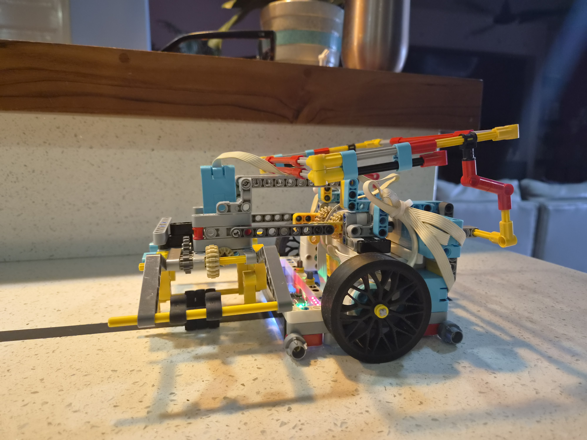
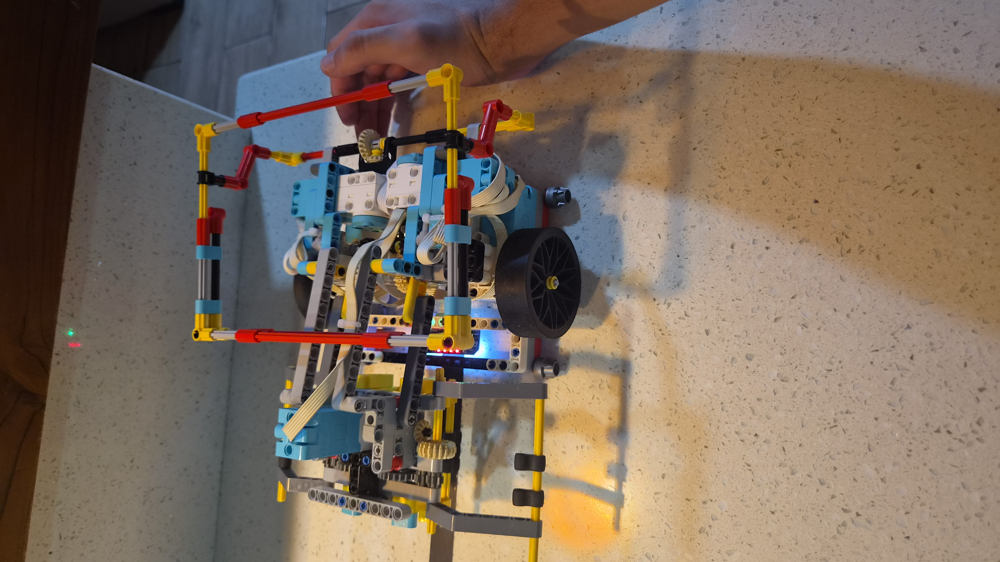

# Proyecto WRO 2026 Senior - Mosaic Masters
## 1. Contexto y Estrategia del Reto
Este repositorio contiene el código y la documentación mecánica de nuestro robot diseñado para la categoría Senior de la World Robot Olympiad (WRO) 2026, bajo el tema "Robots Meet Culture - Mosaic Masters".

**Nuestra Estrategia:**
El desarrollo de este robot nace de una idea clara: priorizar un diseño **compacto y simple**. Sabemos que resolver la cuadrícula completa del reto es una porqueria en tiempo es mecánicamente posible pero imposible en tiempo. Al crear una base ágil y de menor tamaño, nuestro objetivo es resolver el reto principal en el menor tiempo posible. Esta ventaja temporal es la que nos otorga la posibilidad real de mandarse al reto sorpresa o de completar el resto de las misiones en la mesa sin que se nos quedemos sin tiempo.

## 2. Arquitectura de Hardware
Para lograr un chasis tan compacto, se uso la base de AXIONE para las ruedas STIX y el sensor MBC 

*   **Microcontrolador Principal:** Hub Spike Prime.
*   **Tracción Base:** 2 Motores grandes Spike Prime, encargados del desplazamiento rápido y preciso en la mesa.
*   **Mecanismos de Manipulación:** 3 Motores pequeños Spike Prime. Estos están dedicados a operar el sistema del elevador, el cuadro y el accionamiento de las garras para dejar los bloques en su lugar.
*   **Sensores:** Se incorporó un sensor de línea **MBC de Axione**. Este sensor externo nos permite una lectura de alto contraste muchísimo más rápida y estable para los seguimientos de ruta.
*   **Ruedas:** Llantas modulares completas **STIX** (valoradas por su precisión y bajo deslizamiento), las cuales nos aseguran la tracción necesaria para no perder lecturas del giroscopio por culpa de derrapes bruscos.

### Configuración de Puertos
Para facilitar las reparaciones rápidas en competencia y la lectura del código, el mapeo de los puertos quedó definido de la siguiente manera en nuestro programa principal:
# Tracción Base
left_motor = Motor(Port.F, Direction.COUNTERCLOCKWISE)
right_motor = Motor(Port.B, Direction.CLOCKWISE)
# Manipuladores y Sensores
line = ColorSensor(Port.D)
motorgarras = Motor(Port.C)
motorElevador = Motor(Port.E)
motorcuadro = Motor(Port.A)

## 3. Arquitectura de Software y Lógica de Control
El robot está programado en Python, ejecutándose sobre el firmware personalizado de Pybricks. El código destaca por las siguientes implementaciones técnicas:

*   **Ejecución Asíncrona:** Todo el control de misiones (`Run`) y funciones mecánicas están escritas en rutinas asíncronas (`async def`) utilizando `run_task`. Esto evita cuellos de botella en el procesamiento y permite mover el elevador o abrir garras simultáneamente mientras el robot se desplaza.
*   **Giros mediante Control LQR:** A diferencia de giros básicos, implementamos un Regulador Cuadrático Lineal (LQR). Este utiliza retroalimentación constante del estado del giroscopio (ángulo y velocidad angular) más una ganancia *feedforward* para clavar los ángulos objetivo con una precisión matemática casi perfecta, eliminando la oscilación al frenar.
*   **Seguidor de Línea Dinámico (PID adaptativo):** El algoritmo de seguimiento no usa valores estáticos. Los multiplicadores **Kp** y **Kd** escalan dinámicamente dependiendo de la velocidad de crucero y el factor de aceleración actual del robot. Esto asegura giros suaves a baja velocidad y reacciones agresivas cuando el robot va rápido en rectas largas.

## 4. GALERIA DEL ROBOT

  
  

